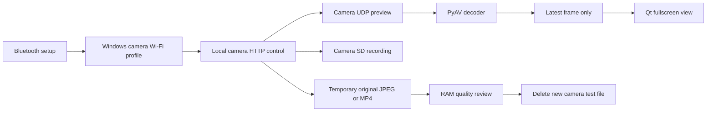

# GoPro LitHero Live Monitor

**Set the tripod. See the frame. Press record.**

A Windows desktop monitor built specifically for **GoPro LIT HERO**. See yourself,
your guitar and your lighting from your computer while the camera stays on its
tripod. Record the real video on the camera's SD card and use the computer as your
framing monitor.

Low-latency Wi-Fi live preview for GoPro LIT HERO on Windows. Frame tripod shots,
check lighting with temporary 12 MP photos, and monitor SD recording in a minimal
fullscreen interface with English and Turkish support.

> Independent community project. Not affiliated with or endorsed by GoPro.
> **Live preview is not 1080p or 4K.** High-resolution quality checks are separate
> temporary captures; your SD recording keeps its selected video preset.

## Why this exists

A tripod makes solo filming easier, but checking your composition from the camera
position does not show what it looks like when you sit down to perform. This app
puts that view on your computer: position the tripod, sit with your instrument,
check headroom and hand placement, adjust the light, then start the SD recording.
It also suits talking-head videos, product shots and other fixed-camera setups.

## Features

- Wi-Fi live preview with a direct UDP / PyAV decoder and a latest-frame-only queue.
- Camera-only fullscreen with controls that appear at the left, top and right edges.
- One-button connection, a remembered camera and automatic connection on launch.
- Camera Wi-Fi credentials read over Bluetooth and stored by Windows, without typing
  a password on every launch or writing it to an application configuration file.
- A **12 MP test photo** for inspecting focus, lighting and detail at actual pixels.
- An optional **video frame** using your current video preset for video framing checks.
- In-memory quality review with zoom, pan, fit and 100% view; no accumulating files.
- SD recording controls and recording-status polling while preview remains available.
- **English by default**, with a persistent **Türkçe** option and runtime switching.
- Mirror and fill-screen display options; the default preserves the entire frame.

## Compatibility and honest limits

| Item | Support |
| --- | --- |
| Camera | **GoPro LIT HERO only**; other models are rejected |
| Tested firmware | H25.03.02.10.00; use firmware with Open GoPro support |
| Tested installation | Windows x64, Python **3.12** |
| Connection | Camera Wi-Fi AP + Bluetooth for setup / Wi-Fi activation |
| Live transport | MPEG-TS / H.264 over local UDP; no preview audio |
| Live source observed | 768×432, approximately 30 fps; 640×480 also observed in another camera state |
| Quality photo | Original 4000×3000 JPEG, 4:3 |
| Video quality frame | Original recording resolution; 3840×2160 and 3840×2880 verified |
| USB / virtual webcam / RTMP | Not implemented |
| Cloud upload / PC recording | Not implemented |

LIT HERO's documented preview start command exposes a UDP port, not a 1080p/4K
selector. USB testing did not increase the preview resolution; the camera rejected
1080p webcam commands. Resizing preview to fit your display cannot add detail.
This application displays the **decoded source resolution**, rather than calling an
upscaled image HD. The [Open GoPro HTTP specification](https://gopro.github.io/OpenGoPro/http/)
and [streaming comparison](https://gopro.github.io/OpenGoPro/docs/faq/) describe the
available paths; the general webcam options do not imply LIT HERO support.

## Install

You need a Windows x64 computer with working Wi-Fi and Bluetooth, Python 3.12 with
its Windows `py` launcher, a charged LIT HERO, and a ready SD card. Internet access
is needed during installation. Monitoring itself is local.

```powershell
git clone https://github.com/enesgocek/gopro-lithero-live-monitor.git
cd gopro-lithero-live-monitor
powershell -ExecutionPolicy Bypass -File .\setup.ps1
```

Alternatively download the repository ZIP, extract it and run `setup.ps1` from
PowerShell. The process-specific execution-policy option above lets that script
run; it does not change your persistent Windows policy.

Setup creates a project-local `.venv` and installs the pinned Windows wheels from
`requirements.lock`, checking their SHA-256 hashes. No separate FFmpeg, VLC,
GoPro SDK, USB driver, or administrator installation is required. PyAV provides
the decoder libraries. The lock file currently targets Python 3.12 / Windows x64;
other OSes and architectures have not been validated.

## First connection

1. Turn on the camera. Select Video, ensure the SD card is ready, and stop any
   existing recording before taking a quality-check photo.
2. On the camera, open the **Quik / app pairing** screen. Enable Bluetooth and Wi-Fi
   on your computer. Close Quik or other camera controllers for this session.
3. Double-click **`start.cmd`**. The app attempts to connect automatically. If needed,
   open **Connection** and select **Connect camera**.
4. Bluetooth reads the camera's Wi-Fi details and enables its access point. Windows
   saves a per-user camera network profile using its native WLAN API, then connects.
   No password entry is required.
5. Live preview opens when a real frame arrives. If more than one camera is found,
   use **Bluetooth / Wi-Fi setup** to choose your camera explicitly.

### Desktop shortcut

After setup, run:

```powershell
powershell -ExecutionPolicy Bypass -File .\tools\create_shortcut.ps1
```

This creates **GoPro LitHero Live Monitor** on your desktop. It opens directly in
fullscreen and connects automatically, without a terminal window or administrator
rights. The shortcut, `start.cmd` and `monitor.cmd` use the isolated launcher;
run setup first so all dependencies are available in the project-local `.venv`.

The computer joins the camera's Wi-Fi network. If Wi-Fi is your only internet
connection, you may lose internet access during monitoring; Ethernet can remain
connected. Windows may request Bluetooth pairing, location permission for WLAN
information, or firewall permission for the Python preview receiver. Allow only
permissions appropriate to your local camera network; the app does not alter your
firewall rules or install a driver.

On later launches, the app first checks an already accessible camera, then reuses
the saved Windows network. If needed, it connects directly to the remembered
Bluetooth camera without a full discovery scan. A reset camera password can be
refreshed from Bluetooth. **Remember this camera** controls application metadata;
unchecking it also disables automatic connection, while Windows retains its WLAN
profile. Remove that profile through Windows Wi-Fi settings if you want to forget
its password as well.

## Your filming workflow

1. **Frame:** put the camera on its tripod and watch the preview from your shooting
   position. Leave **Fill screen** off to see the full frame.
2. **Check quality:** press **F8** or **High-resolution test photo**. Inspect the image
   at **100%** to assess focus and lighting. The camera briefly switches to single-photo
   mode, takes an original JPEG, transfers it into RAM, deletes the new test JPEG,
   and restores the previous video preset.
3. **Check video boundaries:** photos are 4:3 and may differ from your video's crop,
   exposure or processing. Use **Video frame** when you need a check in the current
   video preset. It records a roughly two-second test clip, decodes a full-resolution
   frame in RAM, then deletes only that new test clip.
4. **Return:** choose **Back to live**, press Esc in the review, or close it. Its pixel
   buffer is released and live preview resumes automatically, even if it was paused.
5. **Record:** open the right panel and select **Start SD recording**. Your actual video
   is recorded to the camera's SD card. Preview remains available during recording.
6. **Finish:** select **Stop SD recording** or use the camera shutter button. Closing
   the application or stopping preview alone **does not stop an existing recording**.

Quality checks are disabled during an existing recording. The application never
uses delete-all, delete-last or group deletion: it compares the camera media list
before and after its test and targets only the uniquely identified new file.
If connection loss prevents cleanup, it warns you that the test file may remain.
Do not operate another controller or manually take another capture during a quality
check; ambiguous new media is preserved rather than guessed and deleted.

## Controls and language

| Action | Control |
| --- | --- |
| Start with camera-only fullscreen | `monitor.cmd` |
| Start in a normal window | `start.cmd` |
| Try without a camera | `demo.cmd` |
| Enter / leave fullscreen | F11 or double-click the preview |
| Leave fullscreen / hide panels | Esc in the main window |
| Show connection and language settings | Left edge in fullscreen; Connection button in windowed mode |
| Show view / exit controls | Top edge in fullscreen |
| Show recording / preview controls | Right edge in fullscreen; Controls button in windowed mode |
| High-resolution photo | F8, before recording |
| Review image | Mouse wheel to zoom; drag to pan; Fit / 100% |
| Close review and resume live | Back to live, Esc or the window close button |

Panels stay open under your mouse and hide shortly after you return to the image.
**Mirror** affects only the computer view. **Fill screen** crops display edges; it
never changes the camera recording.

Open **Connection → Language** and choose **English** or **Türkçe**. Changes apply
without reconnecting or disturbing a recording and are remembered locally. A fresh
installation starts in English. You can override the saved choice for a launch:

```powershell
.\.venv\Scripts\python.exe main.py --language en
.\.venv\Scripts\python.exe main.py --language tr
```

Other useful options: `--fullscreen`, `--connect`, `--no-auto-connect`, `--demo`.
Advanced camera IP / UDP port controls are available under **Advanced connection**.
The usual camera AP address is `10.5.5.9` and the default receiver port is `8554`.

## How it works



Camera commands run in one serialized background worker. The UDP receiver binds
before the camera starts streaming so initial H.264 headers are retained. Small
receive buffers, single-thread decoding and a one-frame mailbox reduce accumulated
latency. The UI reads the newest frame and draws it directly in BGR format, avoiding
an extra RGB conversion. An interrupted stream clears stale images rather than
presenting a frozen frame as live. Shutdown cancels workers and releases buffers.

A controlled optical test measured median preview latency falling from approximately
**609 ms to 375 ms** compared with the earlier OpenCV capture path. This is one
camera/PC/network result, not a latency guarantee. A ready-network reconnect was
about **2 seconds**; cold Bluetooth/Wi-Fi activation takes longer. A 12 MP photo check
was about **8 seconds**, including transfer, cleanup and preset restoration.

## Privacy

No cloud service, analytics, telemetry or application account is used. Camera media
is not uploaded. Passwords belong to the Windows WLAN profile, not `.connection.json`.
Quality checks stay in memory on the PC, with no photo/video/cache output directory.
Local preferences contain camera identifiers and are excluded from Git.

The camera's HTTP/UDP protocol is unencrypted and unauthenticated. Use a trusted
camera network and do not expose camera ports to the internet. Memory release is
not forensic erasure of Windows paging or crash dumps. See [SECURITY.md](SECURITY.md)
for the exact storage, network and cleanup boundaries.

## Troubleshooting

- **No camera found:** keep it on, open Quik pairing, check PC Bluetooth, and retry.
  If discovery remains stuck, power-cycle the camera while it is not recording.
- **No Wi-Fi preview:** check that Windows joined the camera network. Close competing
  viewers, check firewall permissions and retry preview. VPNs can interfere with
  local routing. The app does not bypass firewall rules.
- **Photo mode accepts a command but never changes:** stop recording first. If this
  occurs after USB experimentation, unplug USB and fully power the camera off/on.
- **Camera cleanup warning:** inspect its SD card for the new test file. Existing
  recordings are preserved if file identity or camera state cannot be verified.
- **The image looks soft:** verify the displayed source dimensions. Use F8 / 100% for
  a high-resolution quality check; the live stream cannot be upgraded to 4K by scaling.
- **The app waits during shutdown:** connection tasks or cleanup may still be finishing.
  Avoid force-closing during a quality capture if you want automatic SD cleanup.

For redacted, read-only diagnostics:

```powershell
.\.venv\Scripts\python.exe diagnose.py
.\.venv\Scripts\python.exe diagnose.py --scan
```

`--show-identifiers` explicitly reveals Bluetooth identifiers for local troubleshooting;
do not post that output. Never upload your `.connection.json`, WLAN profile exports,
private logs or camera footage when reporting an issue.

## Development

```powershell
.\.venv\Scripts\python.exe -m unittest discover -s tests -v
.\.venv\Scripts\python.exe main.py --demo --smoke-test
.\.venv\Scripts\python.exe tools/release_check.py
```

Tests use synthetic credentials and generated media fixtures. Unit tests do not need
a camera. Explicit hardware tests in `tests/` need a real camera; quality checks
create and remove only their own new test media. Hardware screenshots/benchmark
outputs are private local artifacts and must not be committed. The checked-in
release allowlist and optional Git hooks guard against accidental publication.

To enable the local commit/push guard: `git config core.hooksPath .githooks`.
CI runs Windows regression tests, a demo smoke test, publication checks, static
security analysis and a known-vulnerability dependency audit. Dependency updates
should regenerate the lock file and rerun both unit and hardware acceptance tests.

## License

GPL-3.0-only; see [LICENSE](LICENSE). The open-source [PyQt6 license](https://www.riverbankcomputing.com/software/pyqt/)
is GPLv3. Dependencies retain their own licenses; PyAV uses FFmpeg libraries, and
this repository distributes source rather than a bundled executable or camera
firmware. GoPro and LIT HERO are trademarks of their respective owners.
